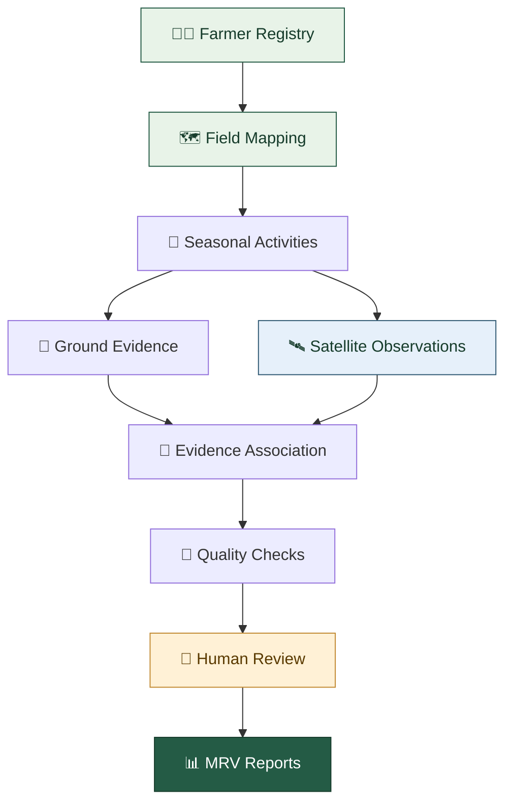

# 🌱 The Carbon Credit

<h3 align="center">Making Every Field Count.</h3>

<p align="center">
  <strong>The intelligence layer for sustainable agriculture.</strong><br/>
  We connect farmers, fields, satellite intelligence, and real-world evidence to make agricultural sustainability measurable and traceable.
</p>

<p align="center">
  <a href="https://thecarboncredit.in/">
    
  </a>
  
  
</p>

<p align="center">
  🌾 Agriculture &nbsp; · &nbsp; 🛰️ Earth Observation &nbsp; · &nbsp; 🧠 Intelligence &nbsp; · &nbsp; 🔎 Verification
</p>

---

## 🌍 The world doesn't need more agricultural data. It needs better evidence.

A field can look green in a satellite image. A farmer can report that a sustainable practice was implemented. A programme can report thousands of acres covered.

But how do we connect all three?

**The Carbon Credit is building the missing link.**

We are developing a digital agricultural MRV platform that connects field-level activities, satellite observations, and ground evidence into a traceable record of what happened, where it happened, and what can actually be verified.

<details>
<summary>💡 Wait, what exactly is MRV?</summary>

MRV stands for **Measurement, Reporting and Verification**.

In agriculture, it means documenting an activity, measuring relevant indicators, organising supporting evidence, and assessing whether the resulting claims are sufficiently supported.

The Carbon Credit aims to make that workflow more connected, transparent, and scalable.

</details>

---

## 🛰️ One field. Multiple layers of intelligence.

<table>
  <tr>
    <td width="50%">
      <h3>👨‍🌾 Farmer Intelligence</h3>
      Structured farmer profiles, field associations, consent records, and seasonal agricultural information.
    </td>
    <td width="50%">
      <h3>🗺️ Field Intelligence</h3>
      Mapped agricultural boundaries, geospatial records, and field-level histories.
    </td>
  </tr>
  <tr>
    <td width="50%">
      <h3>🛰️ Satellite Intelligence</h3>
      Copernicus Sentinel-2 imagery, vegetation indicators, water-related indicators, and temporal observations.
    </td>
    <td width="50%">
      <h3>📸 Ground Evidence</h3>
      Photographs, farmer declarations, activity records, supporting documents, and field observations.
    </td>
  </tr>
  <tr>
    <td width="50%">
      <h3>🔍 Evidence Review</h3>
      Data-quality checks, discrepancy detection, review workflows, and traceable assessment decisions.
    </td>
    <td width="50%">
      <h3>📊 MRV & Reporting</h3>
      Consolidated field records, evidence summaries, and reports designed to support agricultural monitoring.
    </td>
  </tr>
</table>

---

## 🔄 How The Carbon Credit works



<details>
<summary>🔬 What happens behind the scenes?</summary>

1. A farmer and their agricultural field are registered.
2. The field is associated with a relevant crop season.
3. Agricultural activities and supporting evidence are recorded.
4. Available satellite observations are associated with the field and monitoring period.
5. Data-quality checks identify missing or inconsistent information.
6. An authorised reviewer evaluates the available evidence.
7. The resulting assessment is documented with its supporting records and limitations.

The aim is to preserve the relationship between a claim and the evidence used to assess it.

</details>

---

## 🌾 Built for real agricultural challenges

### 💧 Water management

Explore field conditions and seasonal vegetation patterns to support the monitoring of water-management interventions.

### 🌱 Direct Seeded Rice (DSR)

Build a structured record of field-level DSR adoption, supporting evidence, and relevant seasonal observations.

### 🔥 Crop-residue management

Organise activity records and relevant observations to support the assessment of residue-management practices.

### 🌏 Agricultural sustainability

Establish a traceable foundation for monitoring sustainable farming programmes and evaluating environmental outcomes.

> **Our principle:** Satellite data provides observations. Field evidence adds context. Verification requires an appropriate methodology.

No single satellite indicator can independently prove a specific farming practice or establish a carbon-credit claim.

---

## 🧠 The technology behind the intelligence

The Carbon Credit brings together several technical disciplines.

| Layer | Role |
|---|---|
| 🌐 Web application | Farmer, field, and programme interfaces |
| 🗄️ Data infrastructure | Structured agricultural records and evidence relationships |
| 📍 Geospatial systems | Field boundaries, spatial queries, and area calculations |
| 🛰️ Earth observation | Sentinel-2 imagery and derived indicators |
| 🧪 Validation workflows | Quality checks, discrepancy flags, and human review |
| 📈 Reporting | Evidence summaries and monitoring outputs |

### 🛰️ Satellite data, decoded

<details>
<summary>🌿 NDVI — vegetation conditions</summary>

The Normalized Difference Vegetation Index uses red and near-infrared reflectance to examine vegetation greenness and related changes.

It can help contextualise crop development, but it does not independently identify the farming practice responsible for a particular observation.

</details>

<details>
<summary>💧 NDWI — water-related observations</summary>

The Normalized Difference Water Index refers to indices derived from different spectral-band combinations for water-related analysis.

Interpretation depends on the selected formula, image quality, field conditions, and monitoring objective.

</details>

<details>
<summary>🔗 Why connect satellite data with ground evidence?</summary>

Satellite observations provide spatial and temporal context. Farmer records, photographs, and field inspections provide complementary evidence.

Connecting these sources creates a stronger basis for review than relying on any single source in isolation.

</details>

---

## 🧩 Our evidence philosophy

Think of every agricultural claim as a question that needs supporting evidence.

```text
CLAIM
  └── Field and season
       ├── Farmer declaration
       ├── Ground photographs
       ├── Satellite observations
       ├── Activity records
       └── Review decision
              └── Traceable assessment
```

The Carbon Credit is designed around three principles:

- **🔎 Traceability:** Understand where a record came from and which field it concerns.
- **🧠 Context:** Interpret observations alongside relevant agricultural evidence.
- **👤 Accountability:** Preserve review decisions instead of treating automated outputs as unquestionable truth.

---

## 🚧 Where we are headed

Our development priorities are centred on making the platform useful in real agricultural conditions.

- [x] Connect the platform to Copernicus Sentinel-2 imagery.
- [x] Develop field-level satellite intelligence workflows.
- [x] Implement vegetation and water-related indicator visualisation.
- [ ] Strengthen field mapping and seasonal configuration.
- [ ] Expand evidence collection and review workflows.
- [ ] Validate practice-specific monitoring methods with agricultural experts.
- [ ] Pilot the platform with participating farmers and institutional partners.
- [ ] Develop scalable, methodology-aligned MRV reporting.

<sub>These checkmarks reflect the development milestones reported for the project; individual modules may continue to evolve. Future milestones are objectives, not completed capabilities.</sub>

---

## 🤝 Building the future of agricultural intelligence

We believe sustainable agriculture needs more than declarations and disconnected datasets.

It needs a reliable connection between **the farmer, the field, the observation, and the evidence.**

We are interested in working with:

🌾 Farmer Producer Organisations · 🎓 Agricultural researchers · 🏛️ Government institutions · 🌍 Sustainability initiatives · 🛰️ Geospatial technology teams

If you are working on sustainable farming, agricultural monitoring, field verification, or climate-smart agriculture, we would welcome a conversation.

---

## 🚀 Explore The Carbon Credit

<p align="center">
  <a href="https://thecarboncredit.in/">
    
  </a>
</p>

<p align="center">
  <strong>The Carbon Credit</strong><br/>
  From agricultural activity to evidence-backed insight.<br/>
  🌱 Making every field count.
</p>

---

<sub>Built with a focus on agricultural intelligence, geospatial data, and evidence-based sustainability monitoring.</sub>
# VirsaFloww

